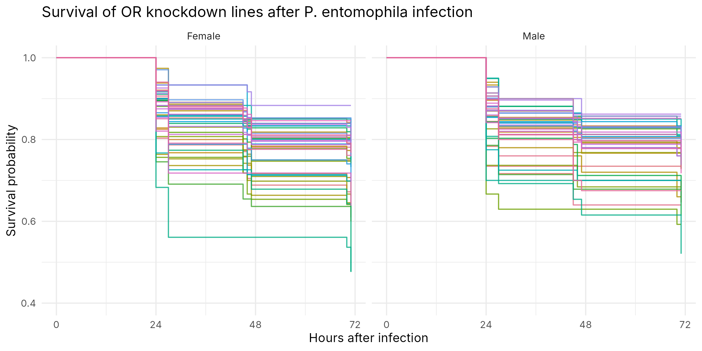
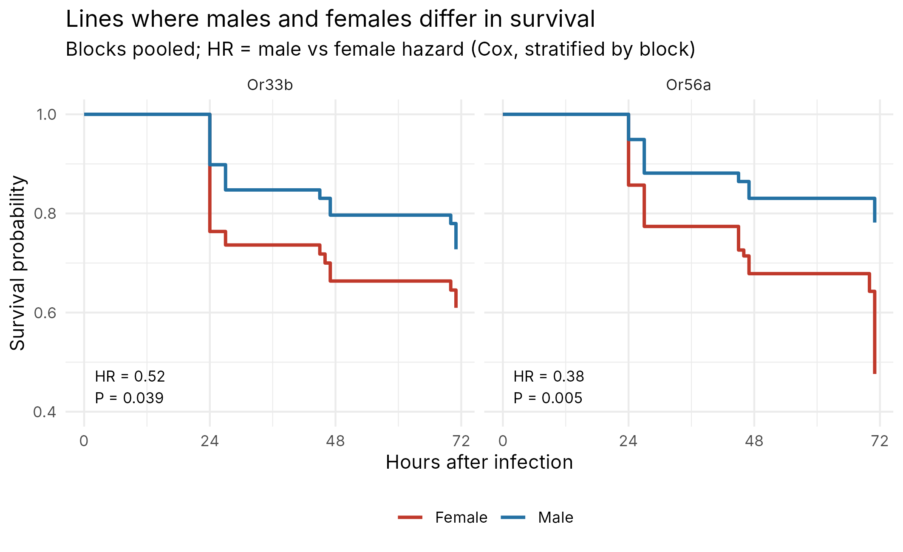
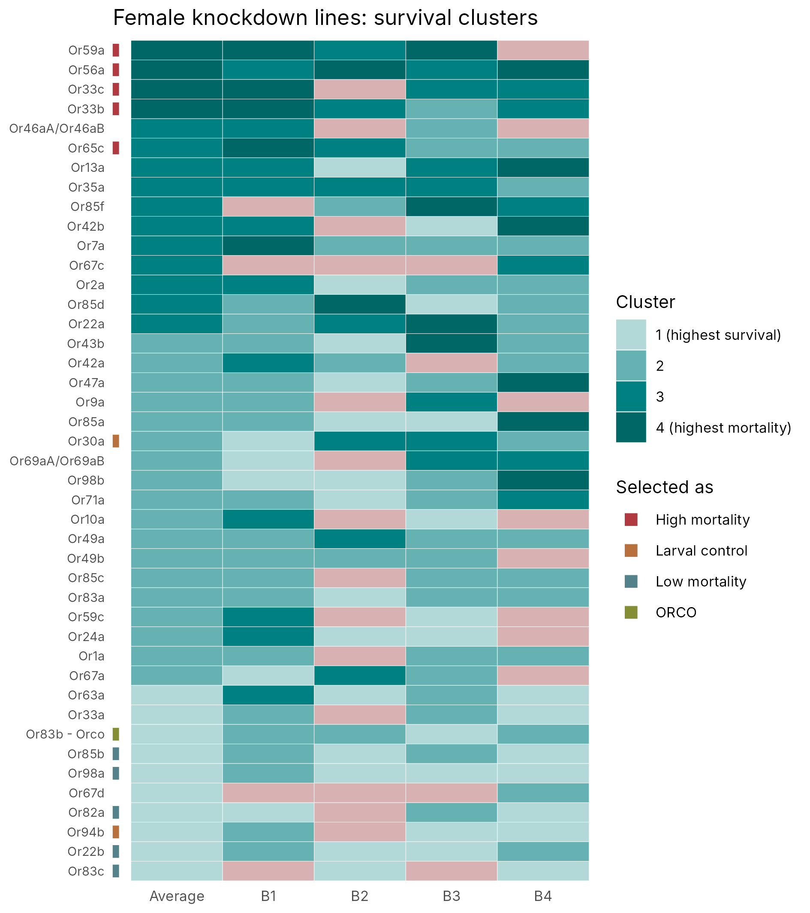

# Olfactory receptors and survival to infection in *Drosophila melanogaster*

Analysis code and data for my MSc thesis in Evolution and Development
(University of Lisbon, CE3C – G2πR Lab, 2023–2025).

**Thesis:** *Determining the effect of olfactory receptors on the survival to
Pseudomonas entomophila infection in Drosophila melanogaster*
([PDF](thesis/MargaridaAntunes_MSc_thesis_provisional.pdf))

## Question

Does knocking down individual olfactory receptor (OR) genes change how well
flies survive a gut infection? Do males and females respond differently?

## Experiment

```
43 OR genes ──RNAi knockdown──► 43 fly lines
                                    │
                    infect with P. entomophila (oral, 3 h)
                                    │
               10 flies per vial, males and females separately
                                    │
                  count deaths at ~24, 48 and 72 h after infection
                                    │
                    repeated in 4 independent blocks
```

**5,875 flies** in total (3,646 females, 2,229 males).

## Analysis pipeline

```
raw lab sheets (vial counts)
   │  01_prepare_survival_data.R     one row per fly: time, died / survived
   ▼
data/processed/  ────────────────────────────────────────────────┐
   │  02_survival_analysis.R    Kaplan-Meier, log-rank, Cox      │
   │  03_sex_differences.R      Cox per line: male vs female     │
   │  04_clustering.R           k-means + Ward clustering        │
   │  05_cluster_heatmaps.R     selected high/low-mortality lines│
   ▼                                                             │
output/tables/   output/figures/  ◄──────────────────────────────┘
```

| Method | R packages |
|---|---|
| Kaplan-Meier curves, log-rank tests | `survival` |
| Cox proportional hazards models (stratified by block) | `survival`, `broom` |
| k-means and Ward hierarchical clustering, silhouette | `stats`, `cluster` |
| Data wrangling and plots | `tidyverse`, `ggrepel` |

## Key results

**Survival differs between knockdown lines in females, not in males.**
Log-rank test across lines, stratified by block: females χ² = 106, df = 42,
P = 2 × 10⁻⁷; males P = 0.19.



**Two lines show a sex difference.** In Or56a and Or33b, males had a lower risk
of death than females (Or56a: HR = 0.38, P = 0.005; Or33b: HR = 0.52,
P = 0.039). Neither stays significant after correcting for testing 41 lines
(FDR), so these are candidates, not firm results.



**Clustering picks out the most extreme lines.** Lines were split into 4
survival clusters on the average and on each block. Lines in the
highest-mortality cluster on average and in at least two blocks were selected
for a follow-up fecundity experiment. Or59a was a high-mortality line in both
sexes.



## Repository structure

```
├── R/
│   ├── utils.R                       shared loading and plotting helpers
│   ├── 01_prepare_survival_data.R    raw sheets → one row per fly (needs raw data)
│   ├── 02_survival_analysis.R
│   ├── 03_sex_differences.R
│   ├── 04_clustering.R
│   ├── 05_cluster_heatmaps.R
│   └── run_all.R                     runs 02–05
├── data/
│   ├── processed/                    one CSV per sex and block (one row per fly)
│   └── clustering/                   clusters used in the thesis
├── output/
│   ├── figures/
│   └── tables/
└── thesis/                           thesis PDF
```

## How to run

```r
install.packages(c("tidyverse", "survival", "survminer", "broom",
                   "ggrepel", "cluster", "readxl", "lubridate"))
```

From the project folder:

```
Rscript R/run_all.R
```

All tables and figures in `output/` are regenerated from `data/processed/`.

## Data

Each file in `data/processed/` has one row per fly:

| Column | Meaning |
|---|---|
| `OR` | knocked-down olfactory receptor gene |
| `Line`, `Stock_Center` | Bloomington stock number |
| `VialNumber` | vial (10 flies) |
| `timeINhours` | hours from infection to death, or to the last check |
| `Censor` | 1 = died, 0 = alive at the end of the experiment |
| `Sex`, `DateStart` | sex and start date of the block |

The raw lab sheets (vial counts per check) are not included. The processed
files were checked by hand after `01_prepare_survival_data.R`.

## Notes and limitations

- **Block effects are large.** Lines differ much more in block 1 than in blocks 2–4,
  which is why all pooled tests are stratified by block.
- **The number of clusters (k = 4) was chosen for practical reasons.** The silhouette score
  favours k = 2–3 (`output/figures/clustering_silhouette.png`), but 4 groups
  separate the extremes more clearly.
- **Recomputed clusters agree with the thesis clusters in 90–100% of lines** for
  every column except male block 4 (48%) (`output/tables/clustering_agreement_with_thesis.csv`).
- **The fecundity (reproductive output) analysis is not in this repository.**

## Credits

Supervised by Élio Sucena. `01_prepare_survival_data.R` is adapted and extended
from a mortality-analysis script by Elvira Lafuente.
